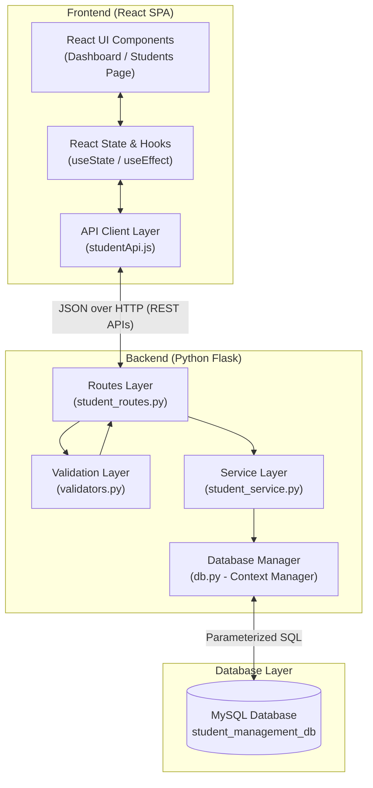

# 🎓 Student Management System (SMS) - Full-Stack Web Application

A clean, robust, and beginner-friendly Full-Stack Student Management System built using **React.js**, **JavaScript**, **CSS3**, **Python Flask**, **MySQL**, and **RESTful APIs**.

Designed specifically for an **Electronics & Instrumentation Engineering** student preparing for **Software Engineering interviews**, this project demonstrates full-stack architecture, database design, parameterized SQL, input validation, transaction management, and responsive frontend design without unnecessary framework complexity.

---

## 📌 Table of Contents

1. [Project Overview](#1-project-overview)
2. [Problem Statement](#2-problem-statement)
3. [Key Features](#3-key-features)
4. [Technology Stack](#4-technology-stack)
5. [System Architecture & Data Flow](#5-system-architecture--data-flow)
6. [Folder Structure](#6-folder-structure)
7. [Database Schema & Data Model](#7-database-schema--data-model)
8. [REST API Documentation](#8-rest-api-documentation)
9. [Prerequisites](#9-prerequisites)
10. [Step-by-Step Setup Guide](#10-step-by-step-setup-guide)
    - [MySQL Database Setup](#step-1-mysql-database-setup)
    - [Backend Setup (Flask)](#step-2-backend-setup-flask)
    - [Frontend Setup (React + Vite)](#step-3-frontend-setup-react--vite)
11. [Running the Application](#11-running-the-application)
12. [Postman API Testing Guide](#12-postman-api-testing-guide)
13. [Running Automated Tests](#13-automated-testing)
14. [Troubleshooting & Common Errors](#14-troubleshooting--common-errors)
15. [Technical Interview Discussion Guide](#15-technical-interview-discussion-guide)
16. [Future Enhancements](#16-future-enhancements)

---

## 1. Project Overview

The **Student Management System** is a centralized administrative portal allowing academic institutions to create, inspect, update, search, and delete student records while tracking real-time enrollment distributions across academic departments and year levels.

### Core Goals:
- **Maintain Data Integrity:** Enforce uniqueness on institutional identifiers (`roll_number`, `email`), valid academic years (1–4), and formatted contact info.
- **Defend Against Vulnerabilities:** 100% parameterized SQL queries preventing SQL Injection.
- **Deliver Responsive UI/UX:** Fast, modern React dashboard with debounced search, modal dialogs, and instant toast feedback.
- **Maintain Interview-Grade Simplicity:** Clean, modular code that is easy to explain in a technical interview without bloated external dependencies.

---

## 2. Problem Statement

Colleges and universities often struggle with fragmented student spreadsheets:
1. **Data Inconsistency & Collisions:** Duplicate roll numbers or malformed emails create record collisions.
2. **Lack of Instant Institutional Insights:** Department heads lack real-time visibility into student counts per discipline and cohort.
3. **Security Vulnerabilities:** Naive systems constructed with string-concatenated SQL queries are vulnerable to SQL Injection attacks.
4. **Poor User Experience:** Reloading the entire webpage on every form submit disrupts administrative workflows.

**Solution:** This application provides an atomic, transactional MySQL backend coupled with an interactive Single Page Application (SPA) frontend in React, ensuring real-time responsiveness and rigorous validation.

---

## 3. Key Features

- **Executive Analytics Dashboard:**
  - Real-time KPI summary cards (Total Students, Department Count, Senior Cohort, Freshman Cohort).
  - Department breakdown progress bars showing percentages and counts.
  - 4-year curriculum enrollment distribution.
  - Recent student registrations table with quick link to directory.
- **Full CRUD Management:**
  - **Create:** Modal form with real-time field validation and duplicate check.
  - **Read:** Formatted student table with roll number badges, department pills, and quick action icons.
  - **Update:** Pre-filled edit form with change detection and conflict checks.
  - **Delete:** Safety confirmation dialog showing student name and roll number before permanent deletion.
- **Debounced Live Search & Filtering:**
  - Search by full name, roll number, or department with a 350ms debounce to prevent API flooding.
  - Dropdown filter by academic department.
  - Dropdown filter by academic year (1st, 2nd, 3rd, 4th Year).
- **Comprehensive User Feedback:**
  - Auto-dismissing success, error, and informational toast notifications.
  - Inline field-level error messages directly under form inputs.
  - Loading spinners during asynchronous network requests.
  - Friendly empty-state illustrations when no records exist or search finds zero matches.
- **Student Profile Modal:**
  - Detailed card view displaying enrollment dates, last updated timestamp, contact info, and direct link to edit.

---

## 4. Technology Stack

### Frontend
- **React.js 19**: Component-based UI rendering with Virtual DOM.
- **JavaScript (ES6+)**: Modern syntax (`async`/`await`, destructuring, arrow functions, modules).
- **React Hooks**: `useState` (local state), `useEffect` (side-effects & data fetching), `useCallback` (memoized queries).
- **Fetch API**: Native browser HTTP client for RESTful JSON communication.
- **Vite 8**: Ultra-fast build tool and local development server with API proxying.
- **Lucide React**: Clean, lightweight SVG iconography.
- **Plain CSS3**: Custom design system using CSS custom properties (variables), Flexbox, CSS Grid, and responsive media queries.

### Backend
- **Python 3.12+**: High-level readable backend language.
- **Flask 3.1**: Lightweight, flexible micro-web framework.
- **Flask-CORS**: Secure Cross-Origin Resource Sharing handling.
- **mysql-connector-python**: Official Oracle MySQL database driver for Python.
- **python-dotenv**: Environment variable management keeping credentials out of source code.
- **Pytest**: Industry-standard Python automated testing framework.

### Database
- **MySQL 8.0+ / MariaDB**: Relational Database Management System (RDBMS) with ACID transactions, unique indexes, and foreign constraints.
- **SQLite (Fallback / Testing)**: Built-in Python zero-dependency engine for running isolated automated tests without external database setup.

---

## 5. System Architecture & Data Flow

The application follows a classic 3-Tier Layered Architecture:



### Complete End-to-End Data Flow:
```
1. User types input into React Form
         ↓
2. React validates format client-side (instant feedback)
         ↓
3. studentApi.js dispatches HTTP Request (POST/PUT/GET/DELETE)
         ↓
4. Flask student_routes.py receives request & parses JSON
         ↓
5. validators.py conducts authoritative server-side checks
         ↓
6. student_service.py coordinates business logic & unique conflict checks
         ↓
7. db.py executes parameterized SQL (%s) inside an atomic transaction
         ↓
8. MySQL commits changes and returns affected rows / IDs
         ↓
9. Flask returns structured JSON response with proper HTTP Status Code (200/201/400/404/409)
         ↓
10. React receives JSON, updates state, and renders toast notification
```

---

## 6. Folder Structure

```
d:/PROJECT/
├── .env.example                # Root environment template
├── .gitignore                  # Git exclusions (credentials, node_modules, .venv)
├── README.md                   # Complete documentation
├── backend/
│   ├── app.py                  # Flask entrypoint & application factory
│   ├── config.py               # Environment configuration loader
│   ├── db.py                   # MySQL connection pool & cursor context manager
│   ├── requirements.txt        # Backend Python dependencies
│   ├── .env.example            # Backend-specific environment template
│   ├── routes/
│   │   ├── __init__.py
│   │   └── student_routes.py   # REST API endpoints (GET, POST, PUT, DELETE)
│   ├── services/
│   │   ├── __init__.py
│   │   └── student_service.py  # Business logic & parameterized SQL execution
│   ├── utils/
│   │   ├── __init__.py
│   │   └── validators.py       # Server-side validation rules & sanitization
│   ├── sql/
│   │   └── schema.sql          # MySQL database schema & seed data
│   └── tests/
│       ├── __init__.py
│       └── test_api.py         # Pytest automated test suite (20 tests)
└── frontend/
    ├── package.json            # Node dependencies & npm scripts
    ├── index.html              # Single Page Application HTML host
    ├── vite.config.js          # Vite configuration & dev API proxy
    └── src/
        ├── main.jsx            # React root mount
        ├── App.jsx             # Top-level shell with navigation & toasts
        ├── api/
        │   └── studentApi.js   # Centralized Fetch API client
        ├── components/
        │   ├── Sidebar.jsx     # Navigation sidebar
        │   ├── Header.jsx      # Top header with health indicator & profile
        │   ├── StatCard.jsx    # Metric KPI summary card
        │   ├── SearchBar.jsx   # Debounced search bar
        │   ├── StudentTable.jsx# Tabulated student listing
        │   ├── StudentForm.jsx # Add / Edit modal form
        │   ├── ConfirmDialog.jsx# Delete confirmation modal
        │   ├── StudentDetailModal.jsx # Read-only profile view
        │   └── Notification.jsx# Animated toast alerts
        ├── pages/
        │   ├── Dashboard.jsx   # Analytics & KPI overview
        │   └── Students.jsx    # Complete student directory management
        └── styles/
            ├── global.css      # CSS variables, reset, modal & button styles
            ├── dashboard.css   # Analytics grids, stat cards & progress bars
            └── students.css    # Sidebar, data table, toolbar & toast styles
```

---

## 7. Database Schema & Data Model

### Database Name: `student_management_db`
### Table: `students`

| Column Name | Data Type | Constraints | Description |
| :--- | :--- | :--- | :--- |
| `id` | `INT` | `PRIMARY KEY`, `AUTO_INCREMENT` | Unique internal record identifier |
| `roll_number` | `VARCHAR(50)` | `NOT NULL`, `UNIQUE` | Institutional roll number (e.g. `2024EIE001`) |
| `full_name` | `VARCHAR(100)` | `NOT NULL` | Student's full legal name |
| `email` | `VARCHAR(100)` | `NOT NULL`, `UNIQUE` | Institutional email address |
| `department` | `VARCHAR(50)` | `NOT NULL` | Engineering department / discipline |
| `year` | `INT` | `NOT NULL`, `CHECK (year BETWEEN 1 AND 4)` | Academic year level (1 to 4) |
| `phone` | `VARCHAR(20)` | `NULL` | Optional contact telephone number |
| `created_at` | `TIMESTAMP` | `DEFAULT CURRENT_TIMESTAMP` | Automatic record creation timestamp |
| `updated_at` | `TIMESTAMP` | `DEFAULT CURRENT_TIMESTAMP ON UPDATE CURRENT_TIMESTAMP` | Automatic update timestamp |

### Indexes:
- `idx_students_roll_number` on `roll_number` (speeds up roll number lookups).
- `idx_students_full_name` on `full_name` (speeds up wildcard name searches).
- `idx_students_department` on `department` (speeds up department filtering and group-by stats).

---

## 8. REST API Documentation

All API routes are prefixed with `/api`. Responses are uniformly formatted as JSON.

| Method | Endpoint | Description | Status Codes |
| :--- | :--- | :--- | :--- |
| **GET** | `/api/health` | Verify server status & database connection | `200 OK`, `503 Service Unavailable` |
| **GET** | `/api/students` | Retrieve all student records | `200 OK`, `500 Server Error` |
| **GET** | `/api/students/<id>` | Retrieve single student details by ID | `200 OK`, `404 Not Found` |
| **POST** | `/api/students` | Create a new student record | `201 Created`, `400 Bad Request`, `409 Conflict` |
| **PUT** | `/api/students/<id>` | Update an existing student record | `200 OK`, `400 Bad Request`, `404 Not Found`, `409 Conflict` |
| **DELETE**| `/api/students/<id>` | Delete a student record by ID | `200 OK`, `404 Not Found` |
| **GET** | `/api/students/search?q=<term>` | Search students by name, roll no, or department | `200 OK` |
| **GET** | `/api/dashboard/stats` | Aggregated statistics (totals, dept & year counts) | `200 OK` |

### Sample API Payloads & Responses:

#### 1. Create Student (`POST /api/students`)
**Request Body:**
```json
{
  "roll_number": "2024EIE010",
  "full_name": "Rohan Deshmukh",
  "email": "rohan.d@college.edu",
  "department": "Electronics & Instrumentation",
  "year": 3,
  "phone": "+91 98765 12345"
}
```
**Response (`201 Created`):**
```json
{
  "success": true,
  "message": "Student created successfully.",
  "data": {
    "id": 9,
    "roll_number": "2024EIE010",
    "full_name": "Rohan Deshmukh",
    "email": "rohan.d@college.edu",
    "department": "Electronics & Instrumentation",
    "year": 3,
    "phone": "+91 98765 12345",
    "created_at": "2026-10-30T10:30:00",
    "updated_at": "2026-10-30T10:30:00"
  }
}
```

#### 2. Duplicate Constraint Violation (`409 Conflict`)
```json
{
  "success": false,
  "error": "A student with roll number '2024EIE010' already exists.",
  "errors": {
    "roll_number": "A student with roll number '2024EIE010' already exists."
  }
}
```

#### 3. Dashboard Statistics (`GET /api/dashboard/stats`)
**Response (`200 OK`):**
```json
{
  "success": true,
  "data": {
    "total_students": 8,
    "department_counts": {
      "Computer Science": 2,
      "Electronics & Instrumentation": 2,
      "Electrical Engineering": 1,
      "Electronics & Communication": 1,
      "Information Technology": 1,
      "Mechanical Engineering": 1
    },
    "year_counts": {
      "1": 2,
      "2": 2,
      "3": 2,
      "4": 2
    },
    "recent_students": [...]
  }
}
```

---

## 9. Prerequisites

Before running the application, make sure you have:
1. **Python 3.10+** (Python 3.12 recommended)
2. **Node.js 18+** and **npm**
3. **MySQL Server 8.0+** (or **XAMPP** / **MariaDB**)

---

## 10. Step-by-Step Setup Guide

### Step 1: MySQL Database Setup

1. Open your MySQL client (MySQL Workbench, MySQL Command Line, or phpMyAdmin in XAMPP).
2. Execute the initialization script provided in [`backend/sql/schema.sql`](backend/sql/schema.sql):

```sql
-- In MySQL Shell or Workbench:
source d:/PROJECT/backend/sql/schema.sql;
```

Or copy-paste the contents of `backend/sql/schema.sql` into your MySQL query window and run. This creates the `student_management_db` database, the `students` table, performance indexes, and seed sample students.

---

### Step 2: Backend Setup (Flask)

1. Open PowerShell or Terminal and navigate to the project root:
```powershell
cd d:\PROJECT
```

2. Activate the virtual environment:
```powershell
# Windows PowerShell:
.\.venv\Scripts\Activate.ps1

# Or Command Prompt (cmd):
.\.venv\Scripts\activate.bat
```

3. Ensure backend dependencies are installed:
```powershell
pip install -r backend/requirements.txt
```

4. Create your backend `.env` configuration file:
Create `backend/.env` (copy from `backend/.env.example`):
```env
FLASK_APP=app.py
FLASK_ENV=development
FLASK_DEBUG=True
PORT=5000

# Set your actual local MySQL credentials:
DB_HOST=localhost
DB_PORT=3306
DB_USER=root
DB_PASSWORD=your_mysql_password
DB_NAME=student_management_db
```

> **Note on Zero-Dependency Testing:** If MySQL is not running on your computer yet, you can set `DB_TYPE=sqlite` in `.env` for zero-configuration local runs! The application automatically initializes SQLite tables and executes the exact same operations seamlessly.

---

### Step 3: Frontend Setup (React + Vite)

1. Open a new terminal window and navigate to the frontend folder:
```powershell
cd d:\PROJECT\frontend
```

2. Install frontend dependencies:
```powershell
npm install
```

---

## 11. Running the Application

### 1. Start the Flask Backend Server
In your first terminal (with `.venv` activated):
```powershell
cd d:\PROJECT\backend
python app.py
```
Backend will start on: **`http://localhost:5000`**

### 2. Start the React Frontend Server
In your second terminal:
```powershell
cd d:\PROJECT\frontend
npm run dev
```
Frontend will start on: **`http://localhost:5173`**

Open **`http://localhost:5173`** in your web browser to access the application!

---

## 12. Postman API Testing Guide

You can test all endpoints using Postman or `curl`:

1. **Health Check:**
   - Method: `GET`
   - URL: `http://localhost:5000/api/health`

2. **Retrieve All Students:**
   - Method: `GET`
   - URL: `http://localhost:5000/api/students`

3. **Register New Student:**
   - Method: `POST`
   - URL: `http://localhost:5000/api/students`
   - Headers: `Content-Type: application/json`
   - Body (raw JSON):
     ```json
     {
       "roll_number": "2024EIE099",
       "full_name": "Kavya S",
       "email": "kavya.s@college.edu",
       "department": "Electronics & Instrumentation",
       "year": 2,
       "phone": "+91 98765 00000"
     }
     ```

4. **Search Students:**
   - Method: `GET`
   - URL: `http://localhost:5000/api/students/search?q=Instrumentation`

5. **Update Student Details:**
   - Method: `PUT`
   - URL: `http://localhost:5000/api/students/1`
   - Headers: `Content-Type: application/json`
   - Body (raw JSON):
     ```json
     {
       "year": 4,
       "phone": "+91 99999 11111"
     }
     ```

6. **Delete Student Record:**
   - Method: `DELETE`
   - URL: `http://localhost:5000/api/students/1`

---

## 13. Automated Testing

The project includes 20 comprehensive unit and integration tests covering all routes, validation rules, HTTP status codes, and database transactions.

To run the automated tests:
```powershell
# From project root with .venv activated:
python -m pytest backend/tests/test_api.py -v
```

### Verified Test Results:
```text
backend/tests/test_api.py::test_health_check PASSED                      [  5%]
backend/tests/test_api.py::test_root_welcome_info PASSED                 [ 10%]
backend/tests/test_api.py::test_create_student_success PASSED            [ 15%]
backend/tests/test_api.py::test_create_student_missing_required_fields PASSED [ 20%]
backend/tests/test_api.py::test_create_student_whitespace_fields PASSED  [ 25%]
backend/tests/test_api.py::test_create_student_invalid_email PASSED      [ 30%]
backend/tests/test_api.py::test_create_student_invalid_year PASSED       [ 35%]
backend/tests/test_api.py::test_create_student_duplicate_roll_number PASSED [ 40%]
backend/tests/test_api.py::test_create_student_duplicate_email PASSED    [ 45%]
backend/tests/test_api.py::test_get_all_students_empty PASSED            [ 50%]
backend/tests/test_api.py::test_get_all_students_populated PASSED        [ 55%]
backend/tests/test_api.py::test_get_student_by_id_success PASSED         [ 60%]
backend/tests/test_api.py::test_get_student_by_id_not_found PASSED       [ 65%]
backend/tests/test_api.py::test_update_student_success PASSED            [ 70%]
backend/tests/test_api.py::test_update_student_not_found PASSED          [ 75%]
backend/tests/test_api.py::test_update_student_conflict PASSED           [ 80%]
backend/tests/test_api.py::test_delete_student_success PASSED            [ 85%]
backend/tests/test_api.py::test_delete_student_not_found PASSED          [ 90%]
backend/tests/test_api.py::test_search_students PASSED                   [ 95%]
backend/tests/test_api.py::test_dashboard_stats PASSED                   [100%]

============================= 20 passed in 1.41s ==============================
```

---

## 14. Troubleshooting & Common Errors

### 1. `Can't connect to MySQL server on 'localhost' (10061)`
- **Reason:** The MySQL service is not running on your computer.
- **Solution:** 
  - On Windows, open `services.msc` and verify that the `MySQL` or `MySQL80` service is **Running**.
  - In XAMPP, open the XAMPP Control Panel and click **Start** next to MySQL.
  - Alternatively, test locally by setting `DB_TYPE=sqlite` in `backend/.env`.

### 2. `Access denied for user 'root'@'localhost'`
- **Reason:** Incorrect database password in `backend/.env`.
- **Solution:** Update `DB_PASSWORD` in `backend/.env` to match your local MySQL root password.

### 3. `CORS policy: No 'Access-Control-Allow-Origin' header`
- **Reason:** Direct API calls from a different port without CORS headers.
- **Solution:** `Flask-CORS` is enabled in `app.py`. Ensure requests hit `/api/*`. Additionally, Vite is pre-configured with a development proxy in `vite.config.js`.

### 4. `Port 5000 is already in use`
- **Reason:** Another process is occupying port 5000.
- **Solution:** Change `PORT=5001` in `backend/.env` and adjust the proxy target in `frontend/vite.config.js`.

---

## 15. Technical Interview Discussion Guide

As an **Electronics & Instrumentation Engineering** student interviewing for software engineering roles, interviewers will appreciate your ability to explain core computer science concepts demonstrated in this project:

### Q1: Why did you separate Routes, Services, and Validators?
> *"In instrumentation, we maintain modular isolation between sensor conditioning, analog-to-digital conversion, and digital processing so failures in one stage don't contaminate the others. Similarly in software, **Separation of Concerns** means `student_routes.py` only handles HTTP parsing and status codes, `validators.py` enforces data integrity rules, and `student_service.py` executes SQL queries. This makes unit testing straightforward and code maintenance painless."*

### Q2: How did you prevent SQL Injection?
> *"I never use Python f-strings or string concatenation (`+`) to build SQL queries. Instead, I use **parameterized queries** with `%s` placeholders. When parameters are sent to `mysql-connector-python`, the database engine treats input parameters strictly as literal values rather than executable SQL commands, completely neutralizing SQL Injection attempts."*

### Q3: Why is server-side validation necessary if client-side validation already exists?
> *"Client-side validation in React improves user experience by providing instant visual feedback without waiting for a network round-trip. However, client-side validation can be bypassed by an attacker using Postman, `curl`, or browser developer tools. Therefore, backend validation in `validators.py` is the **authoritative gatekeeper** protecting database integrity."*

### Q4: Why did you implement debouncing on the search input?
> *"Without debouncing, typing a 10-character student name would fire 10 simultaneous HTTP requests to the Flask server, causing race conditions and unnecessary database load. By implementing a 350ms debounce with `setTimeout` inside a `useEffect` cleanup hook, the request is only dispatched after the user pauses typing."*

### Q5: How do you handle database transactions and connection cleanup?
> *"I created a Python context manager (`@contextmanager get_db_cursor()`) in `db.py`. If an operation succeeds, it calls `conn.commit()`. If any exception is thrown, it executes `conn.rollback()` to prevent partial state corruption, and the `finally` block guarantees that both the cursor and database connection are safely returned/closed, preventing connection leaks."*

---

## 16. Future Enhancements

1. **Role-Based Authentication (RBAC):** Add JWT-based login for Administrators vs Faculty vs Students.
2. **CSV / Excel Export:** Allow administrators to download filtered student rosters as `.csv` or `.xlsx` files.
3. **Student Profile Image Upload:** Store profile pictures on AWS S3 or local static media storage.
4. **Attendance & Marks Modules:** Extend relational schema with `courses`, `enrollments`, and `grades` tables.
5. **Pagination:** Server-side pagination (`LIMIT` and `OFFSET`) for scaling to 50,000+ student records.
